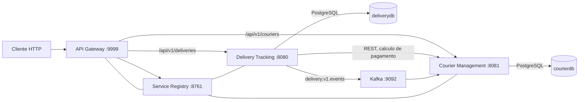

# Algadelivery

Projeto de estudos baseado em arquitetura de microsservicos para rastreamento de entregas e gerenciamento de entregadores.

O sistema separa o ciclo de vida das entregas do cadastro e da capacidade operacional dos entregadores. Os microsservicos se registram em Eureka, recebem requisicoes pelo API Gateway e comunicam eventos de dominio pelo Kafka.

## Arquitetura



### Microsservicos

| Componente | Porta | Responsabilidade |
|---|---:|---|
| Service Registry | 8761 | Registro e descoberta dos servicos com Netflix Eureka |
| API Gateway | 9999 | Entrada HTTP, roteamento por servico e resiliencia |
| Delivery Tracking | 8080 | Entregas, itens, enderecos, estimativas, status e checkpoints |
| Courier Management | 8081 | Cadastro de entregadores, entregas pendentes e pagamento |

### Infraestrutura local

| Recurso | Porta | URL ou acesso |
|---|---:|---|
| PostgreSQL | 5432 | `localhost:5432`, usuario/senha `postgres/postgres` |
| pgAdmin | 8083 | http://localhost:8083 |
| Kafka | 9092 | listener externo em `localhost:9092` |
| Kafka UI | 8084 | http://localhost:8084 |

O Docker Compose fornece PostgreSQL, pgAdmin, Kafka e Kafka UI. Os microsservicos Java continuam sendo iniciados diretamente pela Maven Wrapper.

## Tecnologias

- Java 21
- Spring Boot 3.5.3
- Spring Cloud 2025.0.0
- Spring Data JPA e Hibernate
- PostgreSQL
- Apache Kafka
- Netflix Eureka
- Spring Cloud Gateway
- Resilience4j
- Maven Wrapper
- Docker Compose
- Lombok
- JUnit 5 e REST Assured

## Modelo de dominio

### Delivery Tracking

Uma entrega possui remetente, destinatario, itens, custo estimado, prazo esperado e entregador atribuido. Os estados seguem a transicao:

```text
DRAFT -> WAITING_FOR_COURIER -> IN_TRANSIT -> DELIVERED
```

As operacoes principais sao:

- criar ou editar uma entrega em estado `DRAFT`;
- calcular distancia e prazo;
- calcular taxa de distancia e pagamento estimado ao entregador;
- colocar a entrega em espera por entregador;
- registrar coleta e entrega concluida.

### Courier Management

Um entregador possui nome, telefone, data da ultima entrega concluida e lista de entregas pendentes. A atribuicao e a baixa das entregas sao processadas a partir dos eventos publicados pelo Delivery Tracking.

## Comunicacao entre os servicos

O topico Kafka `delivery.v1.events` possui tres particoes e recebe eventos quando uma entrega muda de etapa:

| Evento | Publicador | Consumidor | Efeito |
|---|---|---|---|
| `delivery-placed-event` | Delivery Tracking | Courier Management | atribui a entrega ao entregador disponivel |
| `delivery-picked-up-event` | Delivery Tracking | Courier Management | registrado, mas o consumidor usa `JsonNode` no estado atual |
| `delivery-fulfilled-event` | Delivery Tracking | Courier Management | remove a entrega da lista de pendencias do entregador |

O calculo de pagamento da entrega pode passar pelo REST do Courier Management. As chamadas sao protegidas por retry e circuit breaker no Delivery Tracking.

## API

Use o Gateway em `http://localhost:9999` para os endpoints de negocio. Os mesmos contratos tambem podem ser chamados diretamente nas portas 8080 e 8081.

### Entregas

| Metodo | Caminho | Descricao |
|---|---|---|
| `POST` | `/api/v1/deliveries` | Cria uma entrega |
| `PUT` | `/api/v1/deliveries/{deliveryId}` | Edita uma entrega em rascunho |
| `GET` | `/api/v1/deliveries?page=0&size=20` | Lista entregas |
| `GET` | `/api/v1/deliveries/{deliveryId}` | Busca uma entrega |
| `POST` | `/api/v1/deliveries/{deliveryId}/placement` | Coloca em espera por entregador |
| `POST` | `/api/v1/deliveries/{deliveryId}/pickups` | Registra a coleta |
| `POST` | `/api/v1/deliveries/{deliveryId}/completion` | Marca como entregue |

Exemplo de corpo para criar uma entrega:

```json
{
  "sender": {
    "zipCode": "01001-000",
    "street": "Praca da Se",
    "number": "100",
    "complement": "",
    "name": "Remetente",
    "phone": "11999990000"
  },
  "recipient": {
    "zipCode": "01310-100",
    "street": "Avenida Paulista",
    "number": "200",
    "complement": "Apto 12",
    "name": "Destinatario",
    "phone": "11999991111"
  },
  "items": [
    {
      "name": "Pacote",
      "quantity": 2
    }
  ]
}
```

Exemplo de coleta:

```json
{
  "courierId": "UUID_DO_ENTREGADOR"
}
```

### Entregadores

| Metodo | Caminho | Descricao |
|---|---|---|
| `POST` | `/api/v1/couriers` | Cadastra um entregador |
| `PUT` | `/api/v1/couriers/{courierId}` | Atualiza um entregador |
| `GET` | `/api/v1/couriers?page=0&size=20` | Lista entregadores |
| `GET` | `/api/v1/couriers/{courierId}` | Busca um entregador |
| `POST` | `/api/v1/couriers/payout-calculation` | Calcula o pagamento pela distancia |

Exemplo de cadastro:

```json
{
  "name": "Maria Silva",
  "phone": "11988887777"
}
```

Exemplo de calculo de pagamento:

```json
{
  "distanceInKm": 12.5
}
```

### Rotas publicas

O Gateway expõe rotas filtradas em `/public/couriers`:

- `GET /public/couriers`
- `GET /public/couriers/{courierId}`

Essas rotas removem os campos internos de entregas pendentes e telefone da resposta.

## Execucao local

### Pre-requisitos

- Docker e Docker Compose
- Java 21
- Nenhum Java process deve ocupar as portas 8080, 8081, 8761 e 9999

Nao e necessario instalar Maven: cada microsservico inclui `mvnw`.

### 1. Inicie a infraestrutura

Na raiz do projeto:

```bash
docker compose up -d
docker compose ps
```

Espere PostgreSQL e Kafka ficarem operacionais.

### 2. Crie os bancos

O Compose cria o servidor PostgreSQL, mas nao cria automaticamente `deliverydb` e `courierdb`. Use o pgAdmin em http://localhost:8083 ou execute:

```bash
docker compose exec postgres psql -U postgres -c "CREATE DATABASE deliverydb;"
docker compose exec postgres psql -U postgres -c "CREATE DATABASE courierdb;"
```

Credenciais do pgAdmin:

- E-mail: `dba@algadelivery.com`
- Senha: `algadelivery`

### 3. Inicie os microsservicos

Abra quatro terminais e siga esta ordem.

**Terminal 1 - Service Registry**

```bash
cd Microservices/Service-Registry
./mvnw spring-boot:run
```

Painel Eureka: http://localhost:8761

**Terminal 2 - Courier Management**

```bash
cd Microservices/Courier-Management
./mvnw spring-boot:run
```

**Terminal 3 - Delivery Tracking**

```bash
cd Microservices/Delivery-Tracking
./mvnw spring-boot:run
```

**Terminal 4 - API Gateway**

```bash
cd Microservices/Gateway
./mvnw spring-boot:run
```

Confirme no Eureka que `COURIER-MANAGEMENT` e `DELIVERY-TRACKING` apareceram antes de exercitar o Gateway.

### 4. Verifique a API

```bash
curl http://localhost:9999/api/v1/couriers
curl http://localhost:9999/api/v1/deliveries
```

Kafka UI: http://localhost:8084  
pgAdmin: http://localhost:8083

### Encerramento

Interrompa os quatro processos Java com `Ctrl+C`. Para parar e remover os containers da infraestrutura:

```bash
docker compose down
```

Para remover tambem os volumes persistentes:

```bash
docker compose down -v
```

## Execucao dos testes

Cada modulo possui testes independentes:

```bash
cd Microservices/Delivery-Tracking && ./mvnw test
cd Microservices/Courier-Management && ./mvnw test
cd Microservices/Service-Registry && ./mvnw test
cd Microservices/Gateway && ./mvnw test
```

Os testes de repositorio podem exigir o perfil e as configuracoes de banco definidos em `src/test/resources/application.yml`.

## Estrutura do repositorio

```text
Algadelivery/
├── docker-compose.yml
└── Microservices/
    ├── Service-Registry/
    ├── Gateway/
    ├── Delivery-Tracking/
    │   ├── api/
    │   ├── domain/
    │   └── infrastructure/
    │       ├── http/
    │       ├── kafka/
    │       └── resilience4j/
    └── Courier-Management/
        ├── api/
        ├── domain/
        └── infrastructure/
            ├── event/
            └── kafka/
```

## Observacoes de desenvolvimento

- `ddl-auto: update` cria ou atualiza as tabelas automaticamente em ambiente local.
- A execucao inclui falhas aleatorias no calculo de pagamento e na listagem de entregas para exercitar retry e circuit breaker.
- Os eventos sao publicados no topico `delivery.v1.events` com mapeamento de tipos JSON por nome curto.
- Os microsservicos dependem do Eureka em `localhost:8761` e dos recursos em `localhost:5432` e `localhost:9092`.
